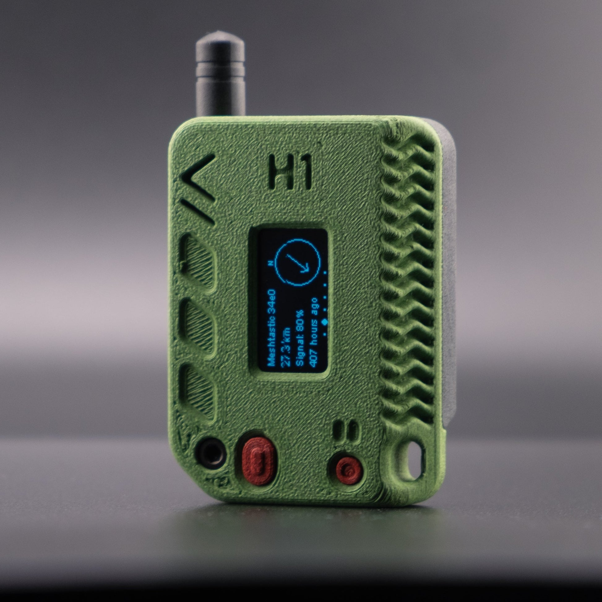

+++
title = 'NixOS is not for beginners!'
summary = 'I often hear people say that NixOS is not a good choice for beginners. Are they right?'
cover = 'testimage.jpg'
date = 2023-01-15T09:00:00-07:00
draft = false
tags = ['article']
+++

### What is a beginner?

People often assume a beginner is someone without much technical knowledge who
wants to use a Linux system as they do a Windows or MacOS one. Although I think
this kind of technical knowledge is quite essential in everyday life, and it
would be great if more people got this, most people will still be wanting to
transition to Linux without the tech knowledge, and stay 'beginners' forever.
NixOS is indeed not for end-users who just want their system to work and install
apps from a store. Instead, it is more for people who like to tinker with their
system, such as hobbyists, power users or developers. But these people can also
be beginners. I, in some aspects, are also a beginner having only a year or so
experience with Linux. I would even argue NixOS is perfect for people like this:

- Rollbacks allow for experimentation -> really frustrating when thing go wrong
  and it breaks your system
- Easy and transparant to contribute to nixpkgs
- Apply Nix in your hobby or professional projects - as much as you want'

Analogy where these things become clear:

- Setting where experimenting doesn't harm you is good
- Setting where you can see the results of your actions is good. -> Arch
  installs that just broke and I had to repeat the installation process but
  couldn't see what I diwrong, so then I came to a point where I was like 'Oh
  wait what did I do again to fix this'.

