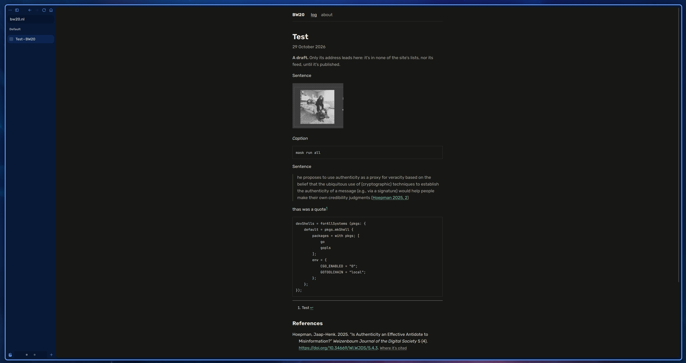

+++
title = "Test"
summary = "s"
date = 2026-10-29T07:12:49Z
generator = "micropub"
references = ["hoepmanAuthenticityEffectiveAntidote2025"]
draft = true
+++

Sentence

  
*Caption*

``` sh
mask run all
```

Sentence

> he proposes to use authenticity as a proxy for veracity based on the belief that the ubiquitous use of (cryptographic) techniques to establish the authenticity of a message (e.g., via a signature) would help people make their own credibility judgments ([Hoepman 2025, 2](#ref-hoepmanAuthenticityEffectiveAntidote2025))

thas was a quote[^1]

``` nix
devShells = forAllSystems (pkgs: {
    default = pkgs.mkShell {
        packages = with pkgs; [
            go
            gopls
        ];
        env = {
            CGO_ENABLED = "0";
            GOTOOLCHAIN = "local";
        };
    };
});
```

Test sentence

[^1]: Test
