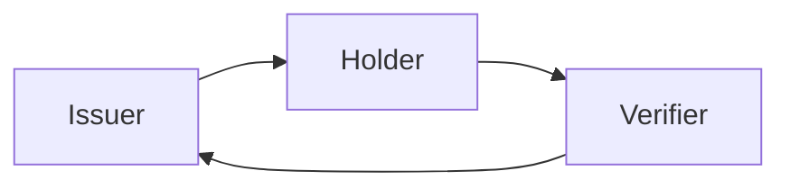
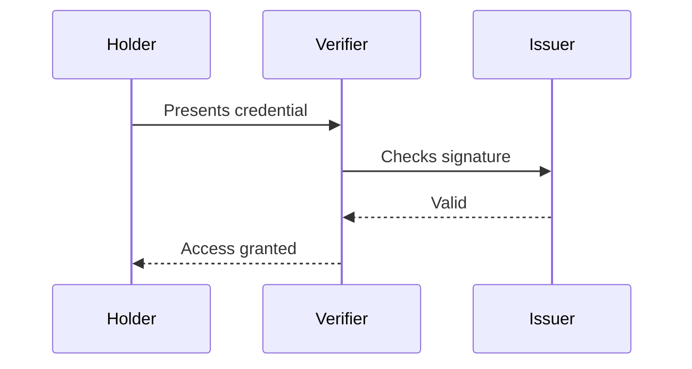

+++
title = "Test"
summary = "A test post that uses every Obsidian element, to check how each one renders on the blog."
date = 2026-10-29T14:23:22Z
generator = "micropub"
draft = true
+++

This post exists to check how every Obsidian element renders on the blog. Each section covers one group of elements.

## Text formatting

highlight.

A line with a hard break at the end  
continues on the next line. A footnote can also be written inline.[^1]

------------------------------------------------------------------------

## Links

- Link to a heading: Signature
- Link to a heading in this note: Callouts
- Link to a note that does not exist yet: Note that does not exist

A paragraph with a block id, so it can be linked to.

Link to that block: Test

## Images

The same image at a fixed width:


An image with a width and height: 

## Callouts

> A plain note callout.

> **A note with a custom title**  
> The body of the callout, with **formatting** and a link.

> Info callout.

> Tip callout.

> Success callout.

> Question callout.

> Warning callout.

> Failure callout.

> Danger callout.

> Bug callout.

> Example callout.

> Quote callout.

> Abstract callout.

> Todo callout.

> **Foldable, closed by default**  
> This is hidden until the reader opens it.

> **Foldable, open by default**  
> This is visible, and the reader can close it.

> **Nested callouts**  
> The outer callout.
>
> > **The inner callout**  
> > Inside the outer one.

## Tables

| Element   | Syntax     | Renders as |
|-----------|------------|------------|
| Highlight | `==text==` | text       |
| Wikilink  | `[[Note]]` | Signature  |

| Left | Centre | Right |
|:-----|:------:|------:|
| a    |   b    |     c |
| 1    |   2    |     3 |

## Math

Inline math: $`e^{i\pi} + 1 = 0`$.

Block math:

``` math
\int_{-\infty}^{\infty} e^{-x^2} \, dx = \sqrt{\pi}
```

``` math
\begin{aligned}
a &= b + c \\
d &= e + f
\end{aligned}
```

## Diagrams





## Embeds

An embedded note:

An embedded heading from another note:

## Tags

Inline tags: test test/nested source/ai

## Footnotes

A second footnote, to check numbering.[^2] A named footnote that is defined at the end.[^3]

[^1]: This is an inline footnote.

[^2]: A second footnote with **formatting** and a link.

[^3]: A footnote with a name instead of a number.
